# UI/UX Bot Maker

**An AI UI/UX designer for Android apps, built on Claude Code.**
Give it an app idea (and optionally a Play Store reference). It thinks like a senior product designer, then builds the screens in Figma:

> **idea → brief → user flow → wireframes → design system → hi-fi Figma screens → self-review → Jetpack Compose**

It stops for your approval after each big step, reviews its own work with a separate reviewer agent, and saves every mistake as a lesson so the next design is better.

<p align="center">
  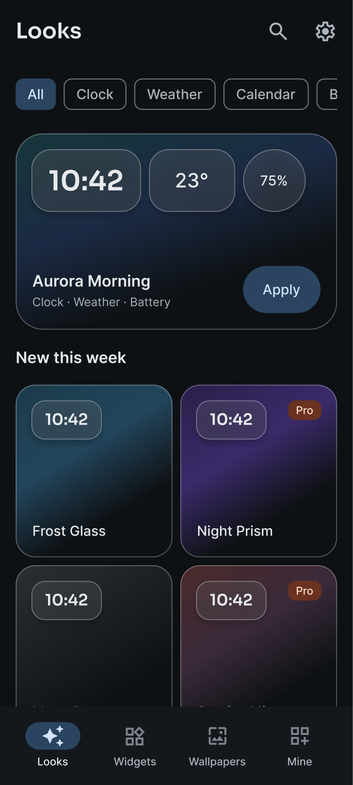&nbsp;
  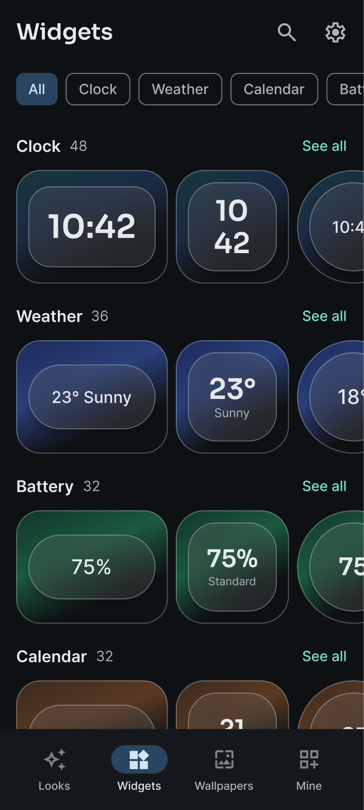&nbsp;
  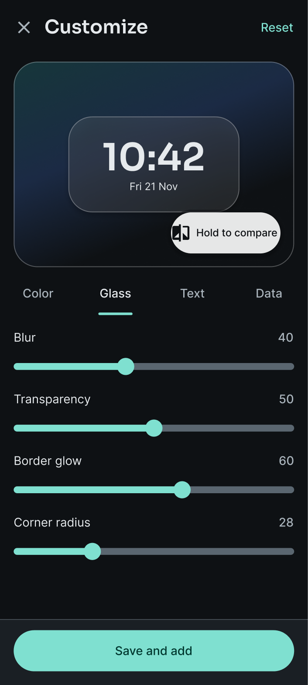
</p>

---

## Results — "Pane", a glass widgets app

Everything below was designed **by the agent in Figma** from a one-line idea, run end-to-end from the Design Studio app:

> *"Build an Android app offering 400+ sleek, customizable glass-style home and lock screen widgets that work standalone."* + a Play Store reference link

| | |
|---|---|
| **Screens** | 12 wireframes (starting with `00-Splash`) · 11 hi-fi screens · 3 extra states (Pro lock, permission needed, permission permanently denied) |
| **Reference** | Analyzed with the reference-analyzer MCP — patterns only (3-tab nav, category rows with live previews, 2-column wallpaper grid). Its brand colors, icons and text were not reused |
| **Design system** | Dark-first Material 3: cool blue-black neutrals with one ice-teal accent so the widgets stay the colorful thing. Signature move: the **"rim-lit pane"** glass card. 42 color pairs checked for WCAG AA by script |
| **Lessons** | 10 lessons from earlier runs applied automatically (e.g. every lock/permission gets a designed outcome, 4 nav destinations, paywall wording that matches Google Play) |
| **Code** | Phase 5 started: 16 Kotlin files — Material 3 theme, tokens, icons, components (`GlassPane`, `LookCard`, `PaneBottomNav`, …) and the first screens in Jetpack Compose |

### Hi-fi screens (Figma)

| Onboarding | Looks | Look detail | Widgets |
|:---:|:---:|:---:|:---:|
| 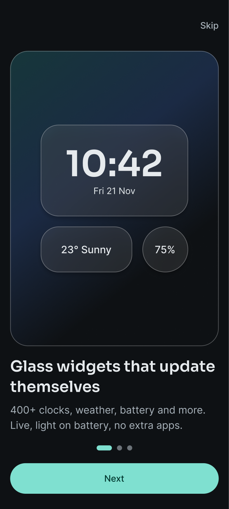 |  |  |  |
| **Widget detail** | **Customize** | **Wallpapers** | **Mine** |
| 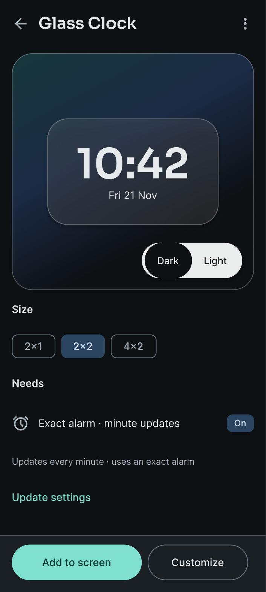 |  | 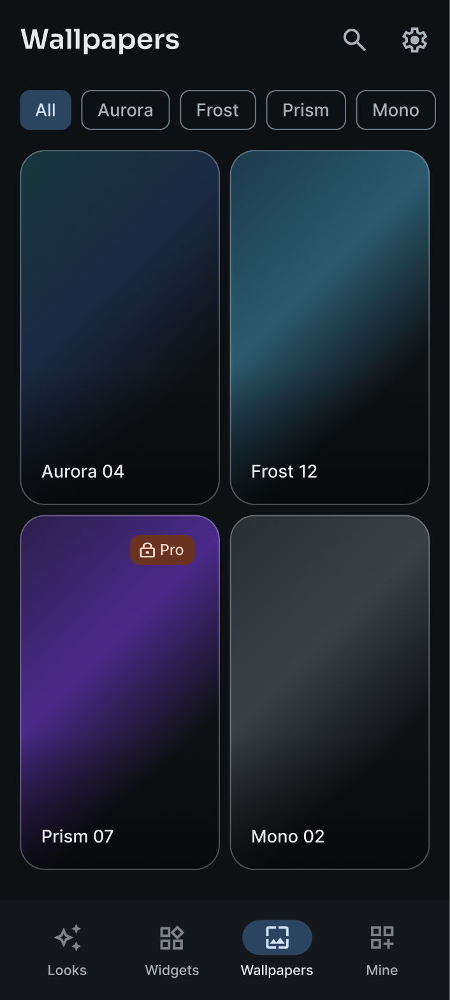 | 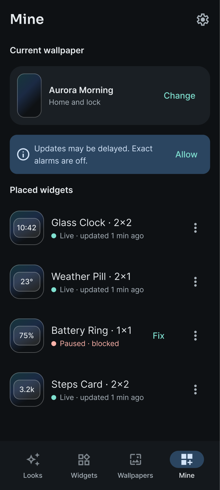 |
| **Settings** | **Pro paywall** | **Permission sheet** | |
| 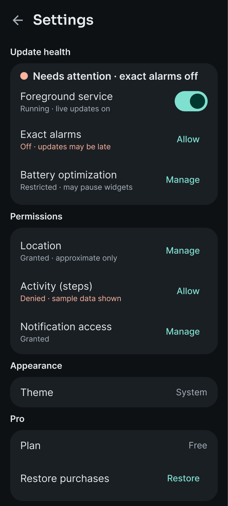 | 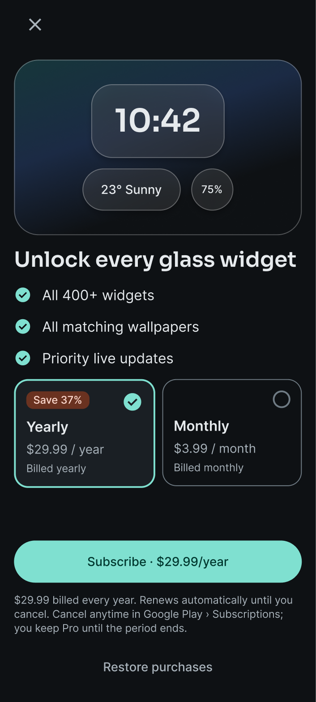 | 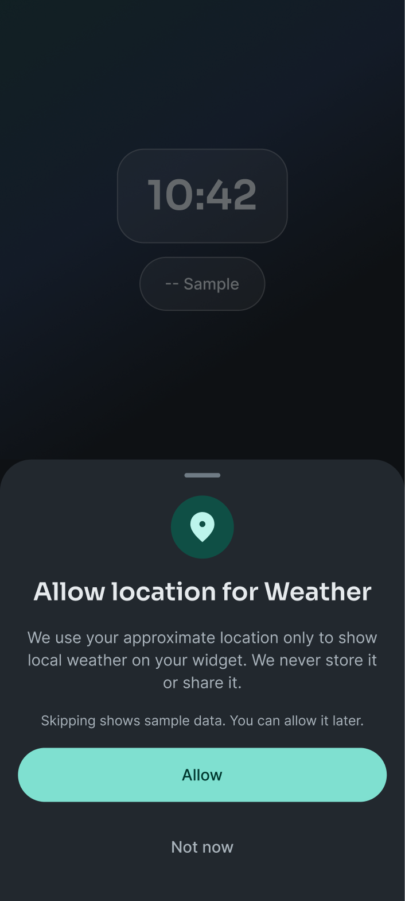 | |

### Locks and permissions get designed outcomes too

Not just the happy path: what happens when a Pro item is tapped, when exact alarms are off, and when location is permanently denied.

| Pro-locked look | Exact alarm off | Location permanently denied |
|:---:|:---:|:---:|
| 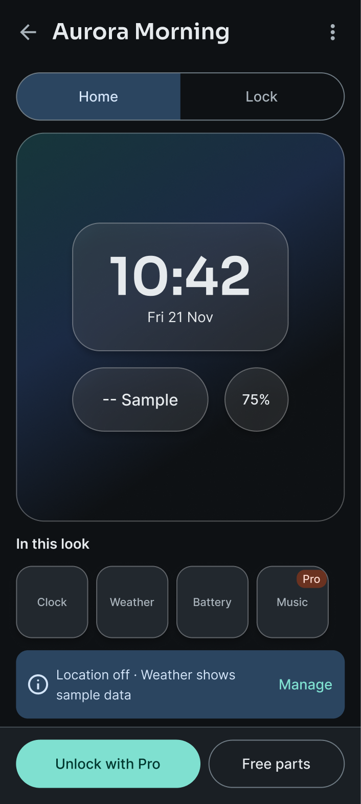 | 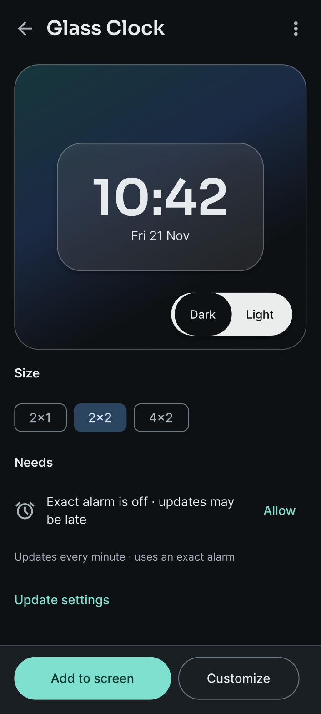 | 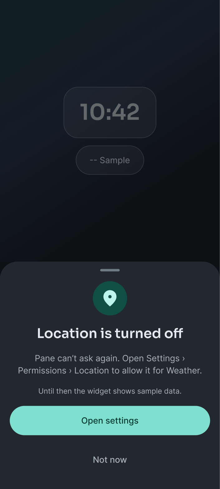 |

### Wireframes first — layout decided before color

All 12 screens as grey boxes, starting with the Android 12+ system splash (icon in its safe circle, optional branding slot).

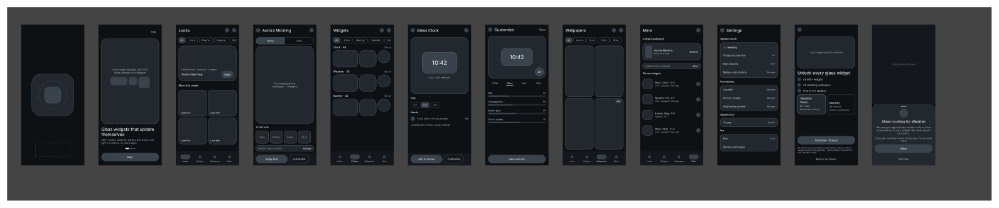

<p align="center">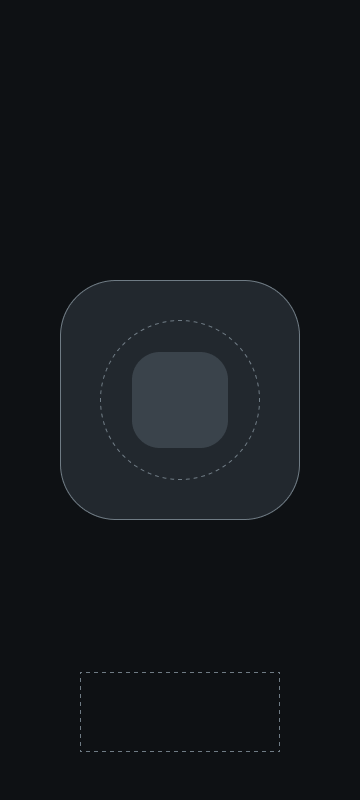</p>

### Real icons, not placeholders

Icons are real **Material Symbols** vectors (Google's official Android set), placed with `figma.createNodeFromSvg` — the active nav item uses the filled variant.

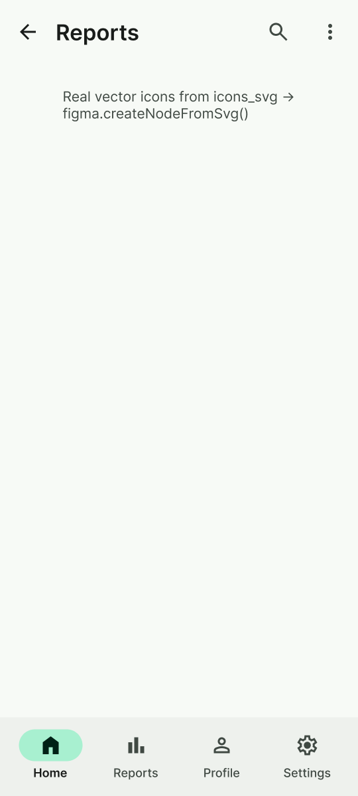

---

## Design Studio — the app that runs the agent

A local web app (your Mac only, `127.0.0.1`) that drives the agent through the Claude Agent SDK using your own Claude Code login.

| Start a design | Read what the agent wrote |
|:---:|:---:|
| 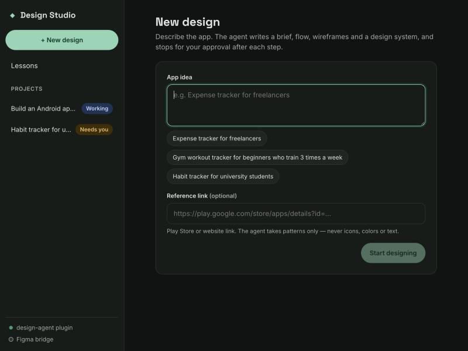 |  |

- **New design** — idea + optional Play Store / website reference
- **Live activity** — the agent's messages and tool calls as they happen
- **Approval gates** — *Approve & continue* or send changes at every step
- **Permission prompts** — Allow / Deny for anything outside the safe tool list
- **Design files** — brief, flow, wireframes, design system, hi-fi specs, rendered
- **Previews** — Figma screenshots and reference screens, saved automatically
- **Lessons** — search, add and promote what the agent has learned


---

## How it works

| Folder | What it is |
|---|---|
| [`design-agent/`](design-agent/README.md) | Claude Code plugin: skills, reviewer subagent, `/design-app` + `/learn`, and an MCP server |
| [`design-studio/`](design-studio/README.md) | The local web app (Express + React + Claude Agent SDK) |
| `.claude-plugin/marketplace.json` | Local marketplace for one-command plugin install |

**Skills**
- `ux-thinking` — the designer's process in fixed order: brief → screens & flow (always starting with the Android 12+ splash) → wireframes → Material 3 design system (contrast checked by `scripts/contrast.py`) → hi-fi specs
- `figma-design` — puts specs on the Figma canvas one screen at a time, with auto layout, named layers and real icons
- `design-critique` + `design-reviewer` agent — fresh-eyes review on a 1–5 severity scale, max 2 fix rounds
- `figma-to-compose` — Material 3 theme, components and screens in Jetpack Compose from the approved design

**MCP server (`reference-analyzer`)**
- `fetch_reference` · `analyze_screens` · `extract_style` · `pattern_report` — learn patterns from a reference app (never its assets, colors or text)
- `icon_search` · `icons_svg` — Material Symbols icons for Figma
- `lessons_add` · `lessons_search` · `lessons_review` — SQLite lessons memory shared by the agent and the app

---

## Quick start

Requirements: Node ≥ 22.5, Claude Code logged in (`claude auth login`), Figma Desktop with the *Figma Desktop Bridge* plugin (for the Figma steps).

```bash
# 1. Install the plugin (run in this folder)
claude plugin marketplace add "$PWD/"
claude plugin install design-agent@osama-local
```

```text
# 2a. Use it in any Claude Code session
/design-agent:design-app "Expense tracker for freelancers" ref: https://play.google.com/store/apps/details?id=...
```

```bash
# 2b. Or run Design Studio
cd design-studio && npm install && npm run build && npm start   # → http://127.0.0.1:5174
```

Teach it something it got wrong (inside Claude Code):
```text
/design-agent:learn "bottom nav mein 5 se zyada items nahi"
```

More sample outputs (brief, flow, wireframes, design system as markdown): [`design-agent/tests/phase1/`](design-agent/tests/phase1/).

---

## Status

| Phase | Status |
|---|---|
| 0 Setup | ✅ Figma connected via the local bridge |
| 1 UX thinking | ✅ Tested on expense tracker, gym tracker, Contour AI and Pane |
| 2 Figma design | ✅ Wireframes, hi-fi and states built in Figma · base component library next |
| 3 Reference analyzer | ✅ Tested on real Play Store links |
| 4 Critique + lessons | ✅ Reviewer loop and SQLite lessons in use |
| 5 Figma → Compose | 🟡 Pane: theme, components and first screens generated; not yet verified with a Gradle build |
| 6 Packaging | ✅ Plugin + local marketplace + web app · Electron desktop app next |

**Copy rule:** reference apps are used for patterns and structure only — never their icons, illustrations, brand colors or text.
