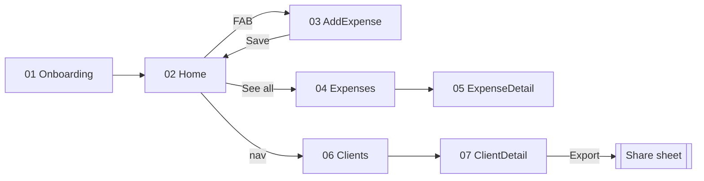

# Screens and flow

| # | Screen | Purpose | Entry from | Key content |
|---|---|---|---|---|
| 01 | Onboarding | Set currency + first client; show value | First launch | 2 intro cards, currency chips, "Add a client" (skippable) |
| 02 | Home | "How much this month?" + add fast | App open, nav | Month total, billable vs personal split, recent 5 expenses, FAB |
| 03 | AddExpense | Core action | FAB on Home/Expenses | Big amount, category chips, client chip, date, receipt, billable toggle |
| 04 | Expenses | Find / review all expenses | Bottom nav, "See all" | Search, filter chips (client, category, billable), grouped list |
| 05 | ExpenseDetail | View/edit one expense | Tap row | Amount, receipt preview, fields, edit, delete (overflow) |
| 06 | Clients | Per-client billable totals | Bottom nav | Client list with this-month billable total |
| 07 | ClientDetail | Bill a client back | Tap client | Billable total, unbilled expenses, "Export for invoice", mark as billed |
| 08 | Settings | Currency, categories, export, backup | Bottom nav | List of settings rows |

**Main flow**: Onboarding → Home → AddExpense → Home (snackbar "Saved · Undo")
Core action taps from Home: **1 (FAB) + fill + 1 (Save) = 2 taps** ✓

**Navigation**: Bottom nav with 4 destinations — Home · Expenses · Clients · Settings (L-001 ✓).
Why: three distinct top-level questions (overview, find, bill) + settings; the core action is a FAB, not a tab.

**Secondary flows**
- Edit: ExpenseDetail → Edit (reuses AddExpense in edit mode) → Save.
- Delete: ExpenseDetail overflow → confirm dialog → back to list with Undo snackbar.
- Bill a client: Clients → ClientDetail → Export (share sheet CSV/PDF) → "Mark these as billed?".
- Add client: from AddExpense client chip ("+ New client" in bottom sheet) or Clients FAB.

