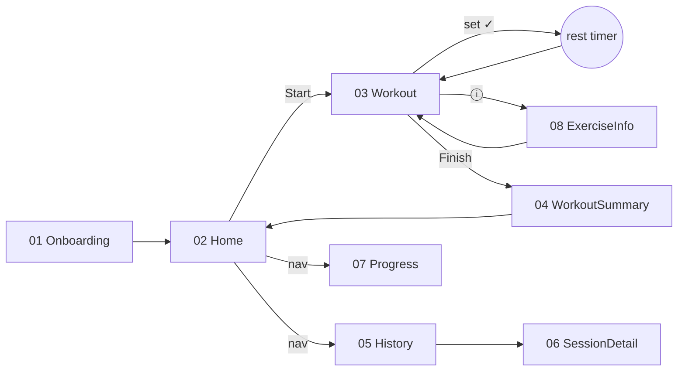

# Screens and flow

| # | Screen | Purpose | Entry from | Key content |
|---|---|---|---|---|
| 01 | Onboarding | Pick goal, days, units, program | First launch | 1 intro card, 2 choice-card questions (goal, training days), units chips, program preview |
| 02 | Home | "What do I do today?" | App open, nav | Today's workout card (exercises, est. time, Start), week streak (3 dots), last workout summary |
| 03 | Workout | Core action: log sets live | Start on Home | Exercise pager, set rows (weight × reps, ✓), rest timer, Finish |
| 04 | WorkoutSummary | Reward + progress proof | Finish on Workout | Duration, volume, PRs ("+2.5 kg on Squat"), streak update, Done |
| 05 | History | See past workouts | Bottom nav | Calendar strip + list of sessions |
| 06 | SessionDetail | Review one past workout | Tap session | Exercises with sets, notes |
| 07 | Progress | "Am I getting stronger?" | Bottom nav | Lift selector chips, simple line of top weight over time, PR list |
| 08 | ExerciseInfo | How to do it (beginners) | ⓘ on Workout | 3 form cues, muscles worked, common mistake |
| 09 | Settings | Units, program, rest time, reminders | Bottom nav | Settings rows |

**Main flow**: Onboarding → Home → Workout (log sets) → WorkoutSummary → Home
Core action taps from Home: **Start (1) → ✓ on a set (1) = 2 taps** for the first set; every following set with the suggested values = **1 tap** ✓

**Navigation**: Bottom nav, 4 items — Home · History · Progress · Settings (L-001 ✓).
Why: three distinct questions (what today / what I did / am I improving) + settings. Workout is a full-screen focused mode **without** bottom nav, so a mis-tap can't leave a live workout.

**Secondary flows**
- Edit a set: tap the weight/reps value → stepper bottom sheet (−/+ 2.5 kg, −/+ 1 rep) → Save.
- Skip/swap exercise: overflow on exercise → "Skip" or "Swap" (list of 3 equivalent exercises).
- Leave a workout mid-way: back → dialog "Save progress and leave?" (Save & leave / Keep training).
- Delete a session: SessionDetail overflow → confirm dialog → Undo snackbar.
- Reminders: Settings → pick training days + time → notification permission primed in context.

